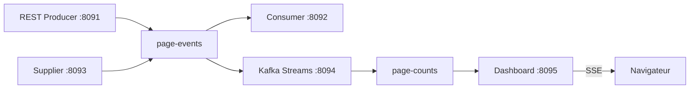

# Activité 4 — Kafka, Spring Cloud Stream et analytics temps réel

Java 21 · Spring Boot 3.5.7 · Spring Cloud Stream 4.3 · Kafka Streams.



## Partie 1 — Installation native avec ZooKeeper

Utiliser Apache Kafka **3.9.1**, dernière génération comportant encore les scripts ZooKeeper, pour suivre la consigne historique. Kafka 4 ne fournit plus ce mode. Télécharger la distribution binaire officielle `kafka_2.13-3.9.1.tgz` depuis les archives Apache, vérifier son SHA-512, puis extraire et se placer dans le dossier.

Dans des terminaux distincts :

```sh
bin/zookeeper-server-start.sh config/zookeeper.properties
bin/kafka-server-start.sh config/server.properties
bin/kafka-topics.sh --bootstrap-server localhost:9092 --create --topic console-demo --partitions 1 --replication-factor 1
bin/kafka-console-consumer.sh --bootstrap-server localhost:9092 --topic console-demo --from-beginning
bin/kafka-console-producer.sh --bootstrap-server localhost:9092 --topic console-demo
```

Saisir un message dans le producer et le retrouver dans le consumer. Arrêter ce broker avant la partie Docker pour libérer le port 9092.

## Partie 2 — Docker Compose ZooKeeper et Kafka

Docker Desktop doit être démarré. Les images 7.7.1 conservent volontairement le mode ZooKeeper demandé.

```sh
docker compose up -d --wait
docker compose exec kafka kafka-topics --bootstrap-server kafka:29092 --create --if-not-exists --topic console-demo --partitions 1 --replication-factor 1
docker compose exec kafka kafka-console-consumer --bootstrap-server kafka:29092 --topic console-demo --from-beginning
docker compose exec kafka kafka-console-producer --bootstrap-server kafka:29092 --topic console-demo
```

Le port 29092 est annoncé aux conteneurs et 9092 aux applications de l'hôte.

## Partie 3 — Spring Cloud Stream

```sh
./mvnw verify
python3 dev.py
```

Le script démarre Compose et les cinq services. Ouvrir http://localhost:8095.

```sh
curl -s -X POST http://localhost:8091/events -H 'Content-Type: application/json' -d '{"page":"home"}'
curl -s http://localhost:8095/api/stats
curl -N http://localhost:8095/api/stream
```

- `producer-service` : REST → StreamBridge → topic `page-events`.
- `consumer-service` : fonction Consumer indépendante et journal des événements.
- `supplier-service` : fonction Supplier, une page aléatoire par seconde.
- `analytics-service` : filtre, groupBy, count, state store et sortie JSON vers `page-counts`.
- `dashboard-service` : consommation des totaux puis diffusion SSE avec reconnexion navigateur.

Le comptage est cumulatif par page, maintenu dans Kafka Streams. Les messages invalides sont filtrés. `PageAnalyticsTest` exécute une vraie topologie avec TopologyTestDriver, vérifie la séparation par page et le rejet d'un événement invalide.
Avec Ctrl-C, les services Java s'arrêtent ; arrêter ensuite les conteneurs avec `docker compose down`. Les topics peuvent conserver les événements entre les démonstrations tant que le broker reste en place.

Références du cours : https://www.youtube.com/watch?v=6O5dQi3l-hU ; https://www.youtube.com/watch?v=8uY7JE_X_Fw ; https://developer.confluent.io/quickstart/kafka-docker/.
